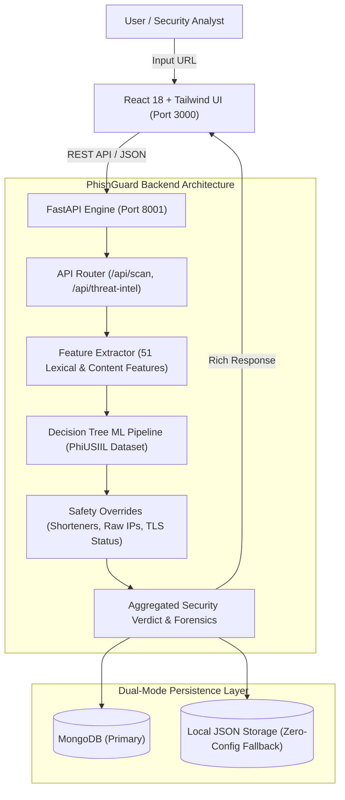

# 🛡️ PhishGuard: Intelligent AI Phishing Detection & Threat Intelligence Platform

<p align="center">
  
  
  
  
  
  
</p>

---

## 📌 Executive Summary

**PhishGuard** is an end-to-end, enterprise-grade AI Phishing Link & URL Detection System equipped with a real-time **AI Threat Intelligence Command Center**. Engineered by **Bala Vishnu** and **Diyanezwaran** at **SRM Institute of Science and Technology, Tiruchirappalli**, PhishGuard combines a high-precision 51-feature Decision Tree Machine Learning pipeline trained on the **PhiUSIIL Phishing URL Dataset** with real-time heuristic safety overrides, live lexical URL forensics, and an interactive cyberpunk threat analytics dashboard.

---

## 🚀 Key Modules & Capabilities

### 1. 🔍 AI Phishing Scanner & Verification Engine
- **51-Dimensional Feature Extraction**: Real-time extraction of lexical, domain-level, and HTML-structure properties.
- **Trained Decision Tree Classifier**: Pre-trained model with automated imputation and standard scaling.
- **Defense-in-Depth Heuristics**: Automatic detection of URL shorteners (e.g. `bit.ly`, `tinyurl.com`), dormant/unreachable domains, and deceptive punycode.

### 2. 🌐 AI Threat Intelligence Command Center
- **Live Threat Map**: Interactive SVG world map featuring glowing radar nodes and simulated real-time attack vectors across major international cyber hubs.
- **Threat Risk Gauge**: Neon semi-circular meter (0–100) scoring URL security posture.
- **Deep URL Forensics**: Comprehensive breakdown of host structure, TLD classification, subdomain depth, raw IP detection, and TLS encryption status.
- **MITRE ATT&CK Intel Cards**: Actionable threat cards covering Phishing (T1566.002), Credential Harvesting (T1556), and Malicious Redirects.
- **Security Recommendations**: Dynamic, context-aware remediation steps linked to global reporting bodies (APWG, Google Safe Browsing).
- **Threat History Timeline**: Chronological security audit stream with expandable forensic inspection.

### 3. 🎓 Academic Thesis & Research Report
- Full academic project report compiled in LaTeX using the official **SRM Institute of Science and Technology** format (`srmuthesis.cls`).
- Ready-to-print 16-page PDF included in `thesis_report/PhishGuard_Project_Report.pdf`.

---

## 🏗️ System Architecture



---

## 💻 Tech Stack

- **Frontend**: React 18, Vite 5, Tailwind CSS, Lucide Icons, Framer Motion, Axios
- **Backend**: FastAPI, Python 3.11, Uvicorn, Motor (Async MongoDB), Pydantic v2
- **Machine Learning**: Scikit-Learn, Pandas, NumPy, PhiUSIIL Phishing Dataset
- **LaTeX / Docs**: SRM Thesis Class (`srmuthesis.cls`), TeX Live / MiKTeX

---

## ⚡ Quick Start

### 1. Prerequisites
- Python 3.10+
- Node.js 18+
- (Optional) MongoDB running on `localhost:27017` (auto-falls back to local JSON if not installed)

### 2. Backend Setup
```bash
cd backend
python -m venv venv
venv\Scripts\activate       # On Windows
pip install -r requirements.txt
python server.py
# Backend runs at http://localhost:8001 (Docs at /docs)
```

### 3. Frontend Setup
```bash
cd frontend
npm install
npm run dev
# Frontend runs at http://localhost:3000
```

### 4. One-Click Launcher (Windows)
Double-click `run_all.bat` or run PowerShell:
```powershell
.\run_all.ps1
```

---

## 👥 Authors

- **Bala Vishnu** — AI Architecture, ML Pipeline & Web Platform ([@balavishnu437-ai](https://github.com/balavishnu437-ai))
- **Diyanezwaran** — Cybersecurity Feature Engineering & Threat Forensics

**SRM Institute of Science and Technology, Tiruchirappalli**

---

## 📄 License
This project is licensed under the MIT License.
